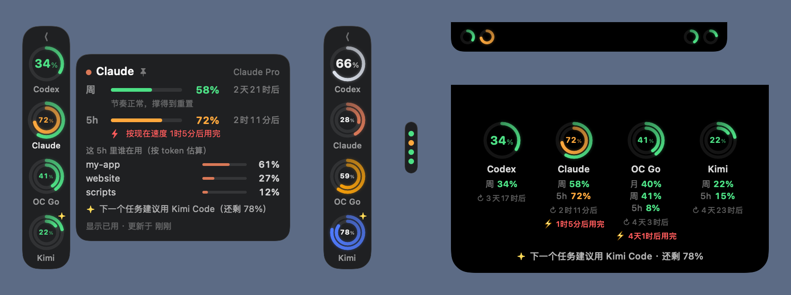

# 用量圈 · Usage Rings

A tiny macOS widget that shows how much of each AI coding plan you've used: one ring per agent, docked to the edge of the screen or wrapped around the MacBook notch.

一个 macOS 小工具：每个 AI 编程订阅一个圆环，贴在屏幕边上或刘海两侧，一眼看到 Codex、Claude、OpenCode Go、Kimi 还剩多少额度。完全在本机运行，不需要安装其他软件。



## 下载安装

1. 到 [Releases](../../releases/latest) 下载 `UsageRings-v*-macOS.zip`，解压后把「用量圈」拖进「应用程序」。支持 Apple 芯片和 Intel，需要 macOS 14 或更新版本。
2. 这个 App 没有经过苹果公证，第一次打开会被系统拦下：打开「系统设置 → 隐私与安全性」，在下方找到「用量圈」，点「仍要打开」。也可以在终端执行：
   ```bash
   xattr -dr com.apple.quarantine /Applications/用量圈.app
   ```
3. 打开后圆环出现在屏幕左侧。右键圆环 →「设置…」可以调整外观、填写 Kimi Code API Key、打开开机启动。

## 功能

- **侧边圆环**：贴在屏幕左边或右边，可以拖动；拖过屏幕中线会自动吸附到另一边，位置会记住
- **灵动岛**：刘海两侧显示迷你圆环，鼠标移上去会展开，显示全部详情
- **收起**：点一下缩成屏幕边缘的一条细竖条，彩色小点表示各家状态
- **详情卡**：悬停或点击圆环，显示每个额度（5 小时 / 周 / 月）的用量和重置倒计时
- **可定制**：大中小三种尺寸；显示"已用"或"剩余"；红绿灯配色或品牌色；透明度；单独隐藏某家；刷新间隔；开机启动
- **登录失效时**：继续显示最后一次读到的数据，并标明是什么时候的
- **节奏预测**：每个额度按目前的速度，算出多久后用完、能不能撑到重置
- **谁在烧额度**：读取 Claude Code 和 Codex 的本地会话记录，算出当前周期里每个会话（项目）占了多少（按 token 加权估算，只统计真正走订阅的模型）
- **下一个用谁**：在撑得到重置的账号里推荐最宽裕的那个，圆环上会出现小星标
- **Codex 离线也能看**：Codex 自己的会话记录里带着额度百分比，断网或登录过期时直接读本地

## 数据来源

| 服务 | 读取的本机登录 | 请求的接口 |
|---|---|---|
| Codex | `~/.codex/auth.json` | `chatgpt.com/backend-api/wham/usage` |
| Claude | 钥匙串 `Claude Code-credentials`（Claude Code 命令行登录） | `api.anthropic.com/api/oauth/usage` |
| OpenCode Go | `~/.local/share/opencode/auth.json` | `opencode.ai/zen/go/v1/usage` |
| Kimi Code | 设置里填的 Kimi Code API Key，或 `~/.kimi-code/credentials/kimi-code.json` | `api.kimi.com/coding/v1/usages` |

- 只**读取**各家官方工具已经保存在本机的登录，从不刷新或改写令牌；令牌只发给对应的官方 HTTPS 地址，并且拒绝重定向。
- 这些接口都是各家没有公开文档的内部接口，以后可能随时变化。
- 会话统计会逐行解析 `~/.claude/projects` 和 `~/.codex/sessions` 里的会话记录，但只取 token 数、时间和项目目录，对话内容不保存、不上传。
- 默认只用内置方式，**不需要安装任何其他软件**。
- Kimi 命令行的登录 15 分钟就过期，只在你使用 Kimi 时有效；想一直读到，在设置里填一个 [Kimi Code API Key](https://www.kimi.com/code/console)。API key 只保存在本机 `~/Library/Application Support/UsageRings/keys.json`（权限 600）。
- 某家暂时读不到时，显示最后一次的读数并标明时间；期间已经过了重置时间的额度会直接归零。
- 可选：装了 [CodexBar](https://github.com/steipete/CodexBar) 的话，可以在设置里把数据来源切到"内置 + CodexBar"，让它补上内置读不到的服务（支持 100 多家）。

## 从源码构建

需要 macOS 14+、Xcode 16+（Swift 6）。

```bash
zsh scripts/package.sh            # 编译、安装到 ~/Applications/用量圈.app 并启动
zsh scripts/package.sh --no-launch
zsh scripts/release.sh            # 跑测试，打包通用版到 dist/ 并生成发布用的 zip
```

右键圆环可以刷新、收起、切换左右或打开设置。

开发时可以用截图模式检查布局，它用真实数据把所有样式渲染成 PNG：

```bash
swift build -c release && .build/release/UsageRings --snapshot /tmp/rings          # 真实数据
swift build -c release && .build/release/UsageRings --snapshot /tmp/rings --demo   # 示例数据
swift test
```

## 致谢

各家用量接口的地址和格式参考了 [CodexBar](https://github.com/steipete/CodexBar)（MIT）的文档和实现。本项目没有包含 CodexBar 的代码。

## 许可证

MIT，见 [LICENSE](LICENSE)。
